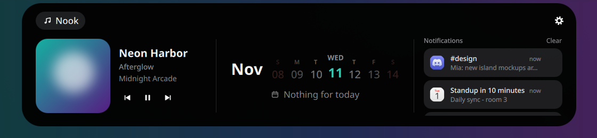
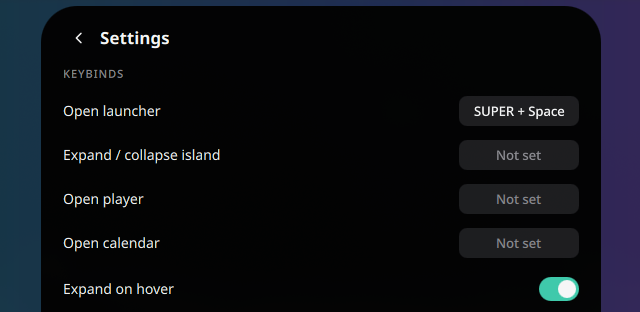

# Dynamic-Larpland

A macOS Dynamic Island / NotchNook-style widget for Wayland compositors (Hyprland first, any wlr-layer-shell
compositor supported), built with [Quickshell](https://quickshell.org).

<p align="center">
  
</p>

It sits as a small black pill at the top of every screen and shows the time. Hover it (or click) and it smoothly
morphs into a panel with your music, a calendar and your notifications. It's also your notification daemon, your
app launcher and a home for the system tray.

> Work in progress. Calendar events and a cava-driven visualizer aren't there yet.

## What you get

### Collapsed: clock and live activities


Idle, the island is just a clock. While music plays it shows the cover and animated bars; a new notification
briefly widens it to show who it's from (see below).

### Expanded: media, week carousel, notifications, tray


- **Media card** — cover, title, album, artist and prev / play-pause / next for any MPRIS player
  (Spotify, browsers, mpv…). The player's app icon sits on the cover.
- **Week carousel** — the days around today; scroll the mouse wheel to spin it day by day.
- **Notifications** — history with app icons (or the sender's picture); click to open, × to dismiss, *Clear* for all.
- **System tray** — tray icons live in the header next to *Nook*; left click activates, right click opens the menu.
- **Gear** — settings (keybinds, expand-on-hover).

### Full player


Click the media card to morph into the full player: seekable progress bar with elapsed / remaining time,
transport controls, visualizer, and a switcher when several players are running. Click the cover to go back.

### Notifications as live activities


Dynamic-Larpland *is* the notification daemon (it replaces mako / dunst / swaync). New notifications pop out of the
pill for a few seconds and are kept in a history that survives restarts.

### Calendar


Scroll the week strip like a carousel; click it for the month view. Click any day to select it (the footer tells you
how far away it is), click a greyed day to jump to that month, scroll to change months, click the title for today.

### Launcher — `Super+Space`


Fuzzy search over your installed apps with icons from your icon theme (`vsc` finds VSCodium). ↑ / ↓ to move,
Enter to launch, Esc or a click outside to close.

### Settings


Click a keybind and press the new combo (Esc cancels, Backspace clears). On Hyprland the binds are applied right away.

## Requirements
- Quickshell >= 0.2 (tested with 0.3.2; `quickshell` or `quickshell-git` on Arch/AUR)
- A compositor with wlr-layer-shell (Hyprland, Sway, niri, river…)

Stop other notification daemons (mako, dunst, swaync, or your shell's own) — Dynamic-Larpland is the notification
daemon.

## Run
```bash
/path/to/Dynamic-Larpland/scripts/run.sh
```
`run.sh` starts `qs -p <repo>` with your desktop icon theme (Quickshell only reads it from `QS_ICON_THEME`).
It detects the theme from GNOME/GTK settings or qt6ct/qt5ct; override with `DYNAMIC_LARPLAND_ICON_THEME=<name>`.
Themes are found in `~/.local/share/icons`, `~/.icons` and `/usr/share/icons`.

Autostart on Hyprland: `hl.exec_cmd("/path/to/Dynamic-Larpland/scripts/run.sh")` in
`hl.on("hyprland.start", …)` (Lua config) or `exec-once = /path/to/Dynamic-Larpland/scripts/run.sh` (hyprlang).

## Keybinds
Change them in the island's settings (gear button). Default: `Super+Space` opens the launcher.

**Hyprland (Lua config):** the settings write `~/.config/dynamic-larpland/binds.lua` and reload Hyprland.
Load it once from your config (e.g. `keybinds.lua`):
```lua
pcall(dofile, os.getenv("HOME") .. "/.config/dynamic-larpland/binds.lua")
```
Remove any other bind on the same keys (e.g. another launcher on `SUPER + Space`).

**Other compositors:** every action is available over IPC — bind these yourself:
```bash
qs -p /path/to/Dynamic-Larpland ipc call island launcher   # also: toggle, expand, collapse, player, calendar, settings
```
e.g. Sway: `bindsym Mod4+space exec qs -p /path/to/Dynamic-Larpland ipc call island launcher`.

## Development
Run `./scripts/dev.sh`: it opens a nested Hyprland window with the island inside (own D-Bus session, ALT as the
modifier, a gradient wallpaper and a demo media player), so your real desktop and shell stay untouched.
The README media were recorded there with `dev/record.py`. See `CLAUDE.md` for details.
